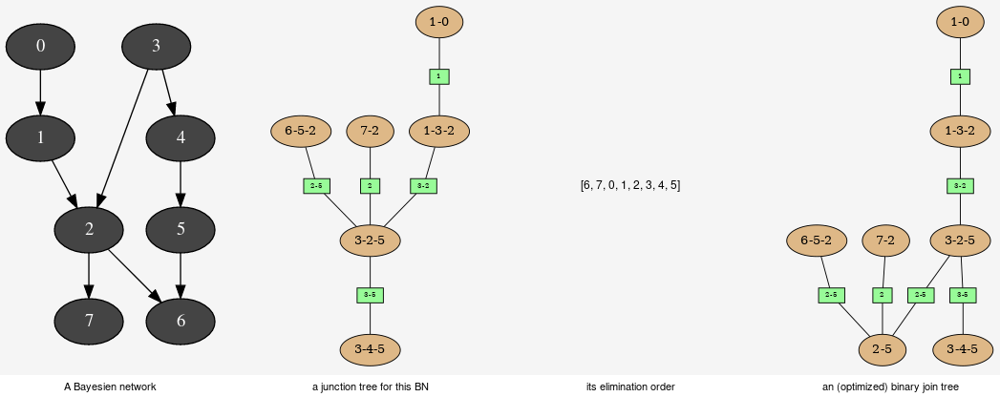

Explanation and analysis
^^^^^^^^^^^^^^^^^^^^^^^^

This tools aimed to provide some different views on the Bayesian network in
order to explore its qualitative and/or quantitave behaviours.

.. pyagrum-class:: pyagrum.JunctionTreeGenerator

.. pyagrum-class:: pyagrum.EssentialGraph

.. pyagrum-class:: pyagrum.MarkovBlanket
