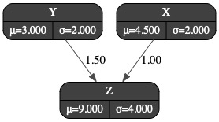

Continuous Linear Gaussian Bayesian Networks
============================================

A Continuous Linear Gaussian (CLG) model is a graphical probabilistic model, often employed for modeling continuous-valued variables in a system. The CLG model assumes that the relationships between variables can be represented as linear equations, and the variables are subject to Gaussian noise.

In a CLG model, each variable is represented as a linear function of its parent variables, with an additional Gaussian noise term. This linear relationship is expressed using regression coefficients, which determine the strength and direction of the influence of the parent variables on the target variable. The Gaussian noise term captures the inherent uncertainty or variability in the system.

The CLG model assumes that the noise terms associated with different variables are independent and normally distributed. This assumption allows for tractable inference and learning procedures. Given observed data, the model parameters, such as regression coefficients and noise variances, can be estimated using methods like maximum likelihood estimation or Bayesian inference.

Structural Equation Modeling (SEM) is a statistical technique used to analyze the relationships among variables. In SEM, the relationships between variables are represented using structural equations, which specify how the variables interact with each other. These equations can be derived from theoretical considerations or based on empirical evidence.

SEM combines elements of factor analysis and path analysis, enabling researchers to simultaneously examine the measurement properties of variables (measurement model) and the causal relationships between variables (structural model). It allows for testing of hypotheses, model comparison, and evaluation of the overall model fit.

SEM provides estimates of the strength and significance of the relationships between variables, as well as the ability to assess model fit, investigate mediation and moderation effects, and conduct various types of model modifications. It is commonly used in social sciences, psychology, economics, and other fields to explore complex relationships and test theoretical models.

**Writing a CLG as a SEM**

`pyagrum.clg.SEM` reads and writes a CLG as a text with one equation per variable, ``X = c + b1*Y1 + b2*Y2 [s]``:
the constant ``c`` is the intercept of ``X`` (0 when absent), each term ``b*Y`` is an arc from ``Y`` to ``X`` with
coefficient ``b``, and the number between brackets, at the end, is the standard deviation of the noise (not its
variance). A variable without parent reads ``X = c[s]``.

- The terms are separated by ``+`` or ``-``; the ``*`` is optional (``1.5*A``, ``1.5 A`` and ``1.5A`` are the same),
  and several terms of the same parent are summed.
- The spaces separate the tokens. A number may use the exponent notation, the exponent being glued to the number:
  ``2e3A`` is 2000 times ``A``, while ``2 e3`` and ``2*e3`` are 2 times a variable ``e3``.
- ``#`` starts a comment. A line without ``=`` continues the previous equation and must start with ``+``, ``-`` or
  ``[``.
- A parent without its own equation, or a part of a line that is not a term, raises a ``SyntaxError``.

.. code-block:: python

   import pyagrum.clg as gclg

   model = gclg.SEM.toclg("""
   # roots: a constant and the standard deviation of the noise
   A = 4[5]
   B = 3[5]
   # D = 2 + 1.5 A + a noise of standard deviation 0.2
   D = 2 + 1.5*A [0.2]
   # an equation may continue on lines starting with +, - or [
   E = 1 + D
       - 0.5 B [2]
   """)
   print(gclg.SEM.tosem(model))  # B=3.0[5.0] A=4.0[5.0] D=2.0+1.5*A[0.2] E=1.0-0.5*B+D[2.0], one per line

**Tutorials**

* `Notebooks on CLGs in pyAgrum <notebooks/72-PyModels_CLG.ipynb>`_.

**Reference**

.. toctree::
   :maxdepth: 3

   clgGaussianVariables
   clgModel
   clgInference
   clgGraphical
   clgLearner
