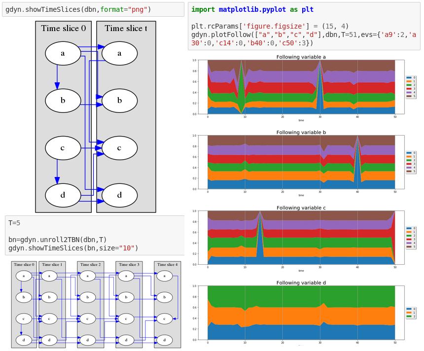

pyagrum.lib.dynamicBN
=====================

dynamic Bayesian Network are a special class of BNs where variables can be subscripted by a (discrete) time. See `this notebook <notebooks/22-Models-dynamicBN.ipynb>`_.

.. automodule:: pyagrum.lib.dynamicBN
    :members:
    :undoc-members:
    :show-inheritance:
    :noindex:
