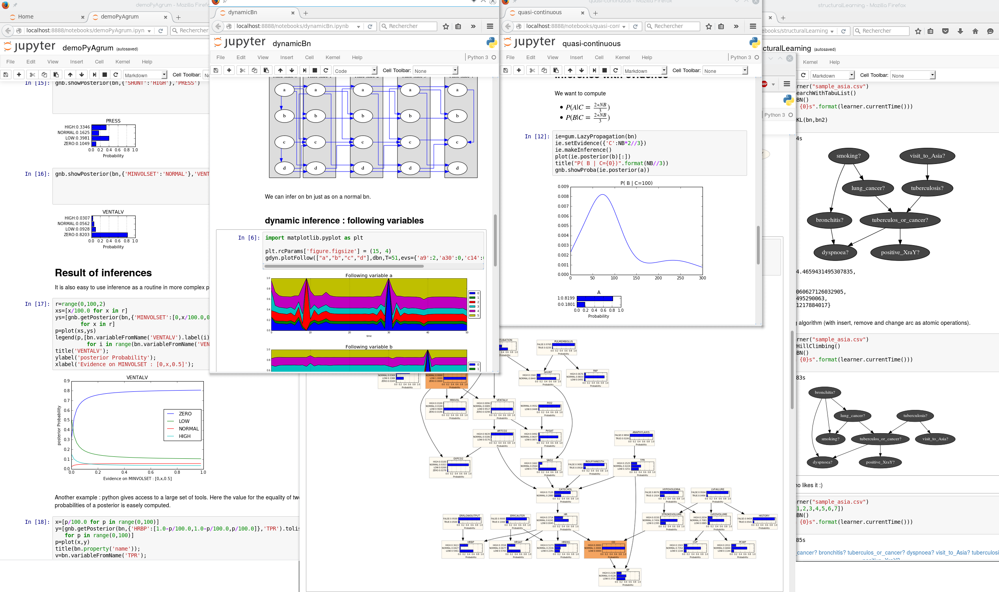

Jupyter notebook with Graphical Models
======================================

``pyagrum.lib.notebook`` aims to facilitate the use of pyAgrum with jupyter notebook (or lab).

Visualization of graphical models
---------------------------------

.. important::

    For many graphical representations functions, the parameter `size` is directly transferred to `graphviz`. Hence, Its format is a string containing an int. However if `size` ends in an exclamation point "!" (such as `size="4!"`), then `size` is taken to be the desired minimum size. In this case, if both dimensions of the drawing are less than size, the drawing is scaled up uniformly until at least one dimension equals its dimension in size.

    .. image:: _static/effect_of_Graphviz_size.png

.. pyagrum-functions::

   pyagrum.lib.notebook.showBN
   pyagrum.lib.notebook.getBN
   pyagrum.lib.notebook.showInfluenceDiagram
   pyagrum.lib.notebook.getInfluenceDiagram
   pyagrum.lib.notebook.showMRF
   pyagrum.lib.notebook.getMRF
   pyagrum.lib.notebook.showCN
   pyagrum.lib.notebook.getCN
   pyagrum.lib.notebook.showInference
   pyagrum.lib.notebook.getInference
   pyagrum.lib.notebook.showJunctionTree
   pyagrum.lib.notebook.getJunctionTree

Visualization of Tensors
---------------------------

.. pyagrum-functions::

   pyagrum.lib.notebook.showProba
   pyagrum.lib.notebook.getPosterior
   pyagrum.lib.notebook.showPosterior
   pyagrum.lib.notebook.getTensor
   pyagrum.lib.notebook.showTensor

Visualization of graphs
-----------------------

.. pyagrum-functions::

   pyagrum.lib.notebook.getDot
   pyagrum.lib.notebook.showDot
   pyagrum.lib.notebook.getGraph
   pyagrum.lib.notebook.showGraph

Visualization of approximation algorithm
----------------------------------------

.. pyagrum-functions::

   pyagrum.lib.notebook.animApproximationScheme

Helpers
-------

.. pyagrum-functions::

   pyagrum.lib.notebook.configuration
   pyagrum.lib.notebook.sideBySide
